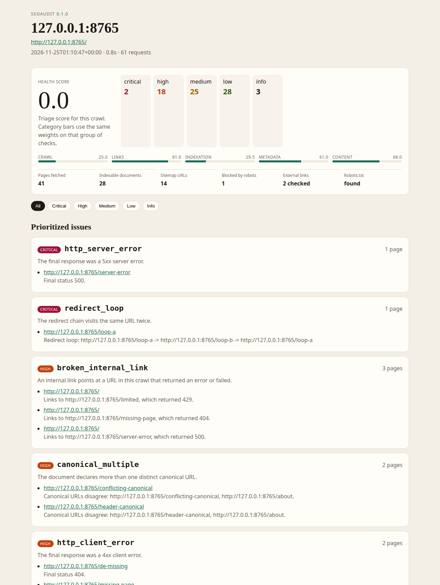

# seoaudit

Technical SEO site audit for a site you are allowed to crawl. Give it a start URL. It fetches pages politely, checks the HTML it actually received, scores the findings by severity, and writes a report you can open or diff.

```bash
seoaudit crawl https://example.com --max-pages 500
```

Built by John Shum. The defaults are 100 pages and 2 requests per second. Only point it at a site you are allowed to audit.

[](https://github.com/photosnob/seo-audit-cli/actions/workflows/ci.yml)

## The problem

A technical audit is a list of concrete faults: a redirect loop, a title used on two indexable URLs, a sitemap URL that returns 404, an hreflang target that does not point back. Full desktop crawlers are heavy, and pasting a site into someone else's crawler is a poor fit for a repeatable check.

`seoaudit` is a local command. It records what this crawl fetched, writes the same findings to the terminal, CSV, JSON, and a standalone HTML file, and can exit non-zero in CI when a chosen severity is present.

## What it checks

The crawler is asynchronous. It reads `robots.txt` before it queues pages, waits between request starts, and stops at `--max-pages` and `--max-depth`. Sitemap URLs are still requested when the depth limit would have skipped them, because the sitemap check is about those URLs. Their outgoing links still obey the depth limit.

| Area | What is reported |
| --- | --- |
| Crawl | Status codes, including 429 and 5xx. Redirect chains (two hops, or three or more), loops, missing `Location` headers, and redirects that leave the site. Timeouts and connection failures. HTML truncated at the download cap. |
| Robots and sitemaps | `robots.txt` from the start host. A missing file is treated as no restrictions. A 4xx or 5xx file is also treated as no restrictions and is reported, because the crawl could not confirm the rules. Disallowed URLs are not fetched. Sitemaps are read from `robots.txt`, `/sitemap.xml`, and `/sitemap_index.xml`, including one level of sitemap indexes and gzip bodies. |
| Sitemap gaps | Indexable pages that are not represented in the sitemap. Sitemap URLs that were not fetched, did not finish at 200, redirect, or are `noindex`. |
| Links | Internal links whose target was fetched and failed. External links, off-site canonicals, and off-site hreflang targets, up to `--max-external`. |
| Titles and descriptions | Missing, duplicate (case-insensitive, on indexable URLs), shorter than 30 characters, or longer than 60. Meta descriptions: missing, duplicate, shorter than 70, or longer than 160. |
| Headings and directives | Missing, empty, or multiple H1s. Canonicals from `<link rel="canonical">` and the `Link` header: missing, conflicting, or not self-referencing. A canonical target that was fetched and did not succeed. `noindex` and `nofollow` from meta robots and `X-Robots-Tag`. |
| Hreflang | Invalid language tags, relative hrefs, a cluster with no self reference, a fetched alternate that does not point back, a target that returned an error, and a target this crawl did not fetch. |
| Structured data and social | JSON-LD present, parseable, and not an empty object. Open Graph `og:title`, `og:description`, and `og:image`. |
| Content | Images with no `alt`, and images with an empty `alt` (called out as informational, because empty alt is valid for decorative images). HTML document size over 200 KB, and over 500 KB. Visible word count under 300, and under 50. Internal click depth of 4 or more. The start document is depth 0. |

Visible word count is the text in `<body>` after `script`, `style`, `noscript`, `template`, and `svg` are removed. Navigation counts. The size check is the HTML document, not images, CSS, and scripts.

Thresholds are recorded in every JSON report under `settings.thresholds`.

## What a crawl does not do

- It does not run JavaScript. Markup that a browser would inject later is invisible here.
- It does not download images, stylesheets, or scripts, and it does not check that an `og:image` URL returns 200.
- It does not measure Core Web Vitals, rankings, or traffic.
- It does not retry a failed request or a 429. A 429 is a finding.
- Python's `robots` parser only honors `Crawl-delay` values that are whole seconds. When one applies, the gap between requests becomes the slower of your `--rate-limit` and that delay.
- With concurrency above 1, `--max-depth` follows the path that discovered each URL. The depth in the report is the shortest link path among pages that were fetched.

The HTML report repeats these limits so a file forwarded on its own still says what the crawl could not see.

## Quickstart

Requires Python 3.11 or newer.

```bash
python -m venv .venv
source .venv/bin/activate
pip install -e .
seoaudit crawl https://example.com --max-pages 500
```

That writes `seoaudit-report/`:

| File | Contents |
| --- | --- |
| `report.html` | Standalone report. No external assets. It sends `noindex` so a published copy is not itself a landing page. |
| `report.json` | Same crawl: pages, issues, score, robots, sitemap, and the settings that produced it. `report_schema` is `1`. |
| `issues.csv` | `severity,code,url,message` |
| `pages.csv` | One row per fetched URL. |

`--fail-on high` exits 1 when any finding is high or critical. Useful as a CI gate. A crawl that finishes, including one that finds issues, exits 0 unless that flag says otherwise. An unusable start URL exits 2.

`seoaudit crawl --help` lists every flag. The user agent is `SeoAuditBot/0.1 (+https://github.com/photosnob/seo-audit-cli)`.

## Sample report

The screenshot and the files under `examples/sample-report/` are one real run of this tool against the local fixture in `tests/fixture_site.py`. That fixture is a small made-up site, "Northwind field notes," built to trip the checks on purpose. It is not an audit of a public website. Regenerate it with:

```bash
python scripts/build_sample_report.py
```

The fixture listens on `http://127.0.0.1:8765/`. A second local server stands in for external links. Nothing in the sample was fetched from the public internet.



Terminal summary from that run:

```text
seoaudit 0.1.0
Start URL: http://127.0.0.1:8765/
Pages fetched: 41
Score: 0.0 / 100

Severity   Count
critical       2
high          18
medium        25
low           28
info           3
```

The highest-count codes were `orphan_page` (18), `hreflang_no_return` (4), and `broken_internal_link` (3). A few of the planted findings:

| Severity | Code | What the crawl recorded |
| --- | --- | --- |
| critical | `redirect_loop` | `/loop-a` → `/loop-b` → `/loop-a` |
| critical | `http_server_error` | `/server-error` returned 500 |
| high | `html_very_large` | `/heavy` was 522,859 bytes |
| high | `sitemap_url_non_200` | `/missing-page` is in the sitemap and returned 404 |
| medium | `thin_content` | `/about` had 63 visible words |
| medium | `canonical_non_self` | `/bad-canonical` points at `/missing-page` |
| low | `deep_page` | `/guides/deep` is 4 clicks from the start URL |

Category scores for the same run, using the formula below on each group of checks: crawl 25.0, links 81.0, indexation 29.5, metadata 61.0, content 68.0. Added together the deductions are 235.5, so the single overall score floors at 0. That is the expected result for a fixture that fails on purpose. The category numbers are there so one bad cluster does not hide the others.

A second run uses a one-page fixture with a title, description, H1, self canonical, JSON-LD, Open Graph tags, an image alt, enough text, and a sitemap that lists the page. Its output is `examples/sample-report/clean-site/`. That run fetched 1 page, reported 0 issues, and scored 100.0.

## How severity is scored

Each finding has a severity. Weights:

| Severity | Weight |
| --- | --- |
| critical | 15 |
| high | 8 |
| medium | 3 |
| low | 1 |
| info | 0 |

For each distinct code and severity, with `count` findings:

```text
points = weight * (min(count, 5) + 1) / 2
```

The first finding counts at the full weight. Each further finding of the same code counts at half weight, and the fifth is the last one that adds points. One repeated template fault therefore caps at three times its weight. Info findings stay in the report and do not change the number.

The overall score starts at 100 and subtracts the points, floored at 0. If the crawl fetched no pages, there is no score. Category scores use the same formula on the findings in that category only.

These are the results asserted in `tests/test_score.py`, not measurements of a live site:

| Input | Score |
| --- | --- |
| One critical `redirect_loop` | 85 |
| Ten high `title_missing` | 76 (the cap stops the deduction at 24 points) |
| Twenty of that same critical code | 55 |
| Only info findings | 100 |
| No pages fetched | no score |

The score is a way to sort this crawl. It is not a prediction of rankings, and it is not a number a search engine publishes.

A redirect chain of two hops is medium. Three or more is high. A redirect loop is critical and is not also charged as a chain. `http_server_error` is critical. `http_client_error` and a broken internal link are high. A broken external link is medium, because the other host is not yours to fix the same way.

## Development

```bash
python -m venv .venv
source .venv/bin/activate
pip install -e ".[dev]"
ruff check src tests
ruff format --check src tests
mypy
pytest
```

CI runs those commands on Python 3.11, 3.12, and 3.13.

Tests crawl fixture sites on `127.0.0.1`. They do not call the public internet. `python tests/fixture_site.py --port 8765` serves the demo site if you want to click through it while a crawl runs.

To use it as a library:

```python
import asyncio
from seoaudit import AuditConfig, run_audit

report = asyncio.run(run_audit(AuditConfig("https://example.com", max_pages=50)))
```

`run_audit` is async and does not write files. `seoaudit.report.write_report` does.

## Roadmap

- Render JavaScript-backed pages, with the raw-HTML result kept as the default.
- Count image, CSS, and script weight, and check that `og:image` URLs respond.
- Word count from the main content, with navigation and footer separated.
- `Retry-After` handling when a host returns 429, still without hiding the 429.
- A second crawl compared with a saved `report.json`.
- Include and exclude patterns for URLs.

## License

MIT. See [LICENSE](LICENSE).
